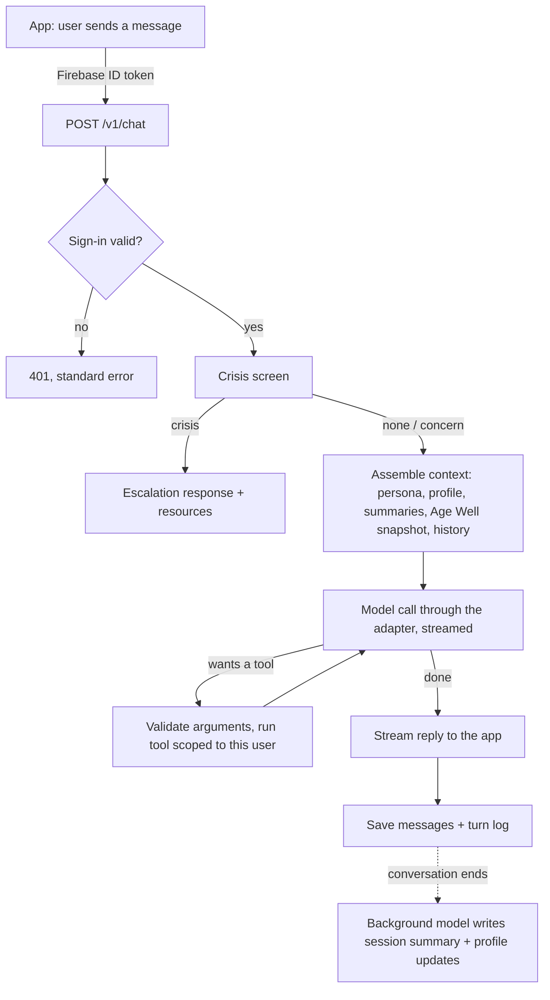

# Architecture

## The idea in one paragraph

Sage is one agent, not a set of routed bots. Each turn, the engine gathers what Sage should
know about this person (profile, recent sessions, Age Well trends, goals), hands it to the
model along with Sage's persona and a toolbox, and lets the model decide what to do: answer,
look something up, check the user's data, or just listen. The engine's job is to give Sage
good context and good tools, keep three firm safety rails in place, and record everything so
we can measure and improve it.

## How a turn will flow

## Components

| Piece | File(s) | Status |
|---|---|---|
| App setup, CORS, request IDs | `main.py`, `engine/logging_setup.py` | Built |
| Settings from environment | `engine/settings.py` | Built |
| Sign-in (Firebase ID tokens) | `engine/auth.py` | Built |
| Errors, one shape everywhere | `engine/errors.py` | Built |
| Supabase client | `engine/db.py` | Built |
| Database schema | `supabase/migrations/` | Built and tested on Postgres 16 + pgvector |
| Shared message/tool/citation types | `engine/types.py` | Built |
| Model adapter interface | `engine/model_adapter.py` | Interface + test fake built; Claude and Gemini adapters next |
| Tool interface + registry | `tools/base.py` | Built; individual tools next |
| Memory interface | `memory/store.py` | Interface + in-memory version built; Supabase version next |
| Crisis screen interface | `safety/crisis.py` | Interface only, by design |
| Persona | `persona/sage.md` | First draft |
| Agent loop | `engine/` | Not started (WS2) |
| Eval harness | `evals/` | Not started (WS6) |

## The three hard rails

1. **Crisis screen before the model.** A rule-based check plus a model flag, with a fixed
   escalation response. It never depends on prompt wording.
2. **Validated tool calls.** `ToolRegistry.invoke` checks arguments against each tool's
   `Input` model before any tool code runs, and every tool is scoped to the signed-in uid.
3. **Age Well math stays in the Age Well engine.** Sage reads and explains results.

Everything else (tone, when to search, when to just listen, when to suggest a next step) is
Sage's judgment, shaped by the persona and measured by evals.

## Where Sage gets its knowledge

- **Model knowledge** for general health understanding.
- **`knowledge_search`** over our cleaned Q&A corpus and curated sources (pgvector).
- **`literature_search`** on PubMed for current research, with PMIDs.
- **`web_search`** for anything recent.
- **The user's own data** through profile, Age Well and goals tools.

## Deployment

One Cloud Run service, `sage-engine`, in `us-central1`, deployed from source. Secrets reach
the service as environment variables from Secret Manager. The service account needs:
Vertex AI User and Secret Manager Secret Accessor. Details in `docs/setup.md`.
