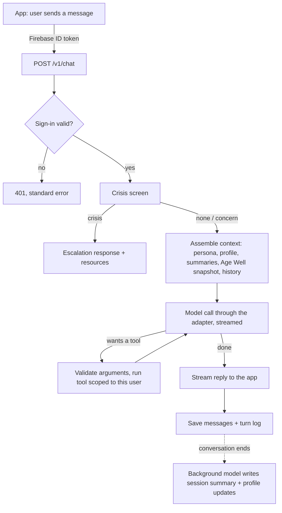

# Architecture

## The idea in one paragraph

Sage is one agent, not a set of routed bots. Each turn, the engine gathers what Sage should
know about this person (profile, recent sessions, Age Well trends, goals), hands it to the
model along with Sage's persona and a toolbox, and lets the model decide what to do: answer,
look something up, check the user's data, or just listen. The engine's job is to give Sage
good context and good tools, keep three firm safety rails in place, and record everything so
we can measure and improve it.

## How a turn will flow

## Components

| Piece | File(s) | Status |
|---|---|---|
| App setup, CORS, request IDs | `main.py`, `engine/logging_setup.py` | Built |
| Settings from environment | `engine/settings.py` | Built |
| Sign-in (Firebase ID tokens) | `engine/auth.py` | Built |
| Errors, one shape everywhere | `engine/errors.py` | Built |
| Routes | `engine/api.py` | Built: chat (streaming), conversations, health, jobs |
| Wiring (which parts get used) | `engine/container.py` | Built |
| Agent loop | `engine/agent.py` | Built and tested with a scripted model |
| Context for each turn | `engine/context.py`, `engine/persona.py` | Built; Age Well source is a placeholder |
| Claude and Gemini adapters | `engine/model_adapter.py` | Built and tested against the SDKs' shapes; not yet run against live Vertex AI |
| Embeddings | `engine/embeddings.py` | Built; used once knowledge search exists |
| Conversations + messages | `engine/conversations.py` | Built (Supabase and in-memory) |
| Memory (profile, summaries) | `memory/` | Built (Supabase and in-memory) |
| Turn logging and cost | `engine/turn_log.py` | Built; prices to be filled in |
| Background summaries | `engine/jobs.py`, `engine/job_auth.py` | Built; needs Cloud Scheduler set up |
| Database schema | `supabase/migrations/` | Built and tested on Postgres 16 + pgvector |
| Tool interface + registry | `tools/base.py`, `tools/__init__.py` | Built; no tools registered yet |
| Crisis screen | `safety/` | Interface only, by design. Chat can't run until it exists |
| Persona | `persona/sage.md` | First draft |
| Eval harness | `evals/` | Not started (WS6) |

## What's left before Sage can talk

1. **Crisis screen** (WS5): implement `CrisisScreen`, register it in `safety/__init__.py`.
2. **Tools** (WS3, WS4): write each one, register it in `tools/__init__.py`.
3. **Age Well source** (WS4): implement `AgeWellSource` and use it in `engine/container.py`.
4. **Persona** tuning, guided by evals.
5. Set `CHAT_ENABLED=true`.

Everything between those pieces (streaming, saving, memory, logging, summaries) already works.

## Switching chat on is deliberately two steps

`CHAT_ENABLED=true` alone isn't enough. `get_sage()` also refuses to build Sage while no
crisis screen is registered, so the endpoint answers 501 until both are true.

## Background job

Cloud Scheduler calls `POST /internal/jobs/close-idle` every 15 minutes or so, signed with a
Google ID token. Conversations that went quiet (30 minutes by default) or that the user
closed get a short summary from the background model, which Sage reads at the start of the
next conversation. A conversation is never summarized twice (`summarized_at`), and one
failure doesn't stop the rest of the batch.

## The three hard rails

1. **Crisis screen before the model.** A rule-based check plus a model flag, with a fixed
   escalation response. It never depends on prompt wording.
2. **Validated tool calls.** `ToolRegistry.invoke` checks arguments against each tool's
   `Input` model before any tool code runs, and every tool is scoped to the signed-in uid.
3. **Age Well math stays in the Age Well engine.** Sage reads and explains results.

Everything else (tone, when to search, when to just listen, when to suggest a next step) is
Sage's judgment, shaped by the persona and measured by evals.

## Where Sage gets its knowledge

- **Model knowledge** for general health understanding.
- **`knowledge_search`** over our cleaned Q&A corpus and curated sources (pgvector).
- **`literature_search`** on PubMed for current research, with PMIDs.
- **`web_search`** for anything recent.
- **The user's own data** through profile, Age Well and goals tools.

## Deployment

One Cloud Run service, `sage-engine`, in `us-central1`, deployed from source. Secrets reach
the service as environment variables from Secret Manager. The service account needs:
Vertex AI User and Secret Manager Secret Accessor. Details in `docs/setup.md`.
